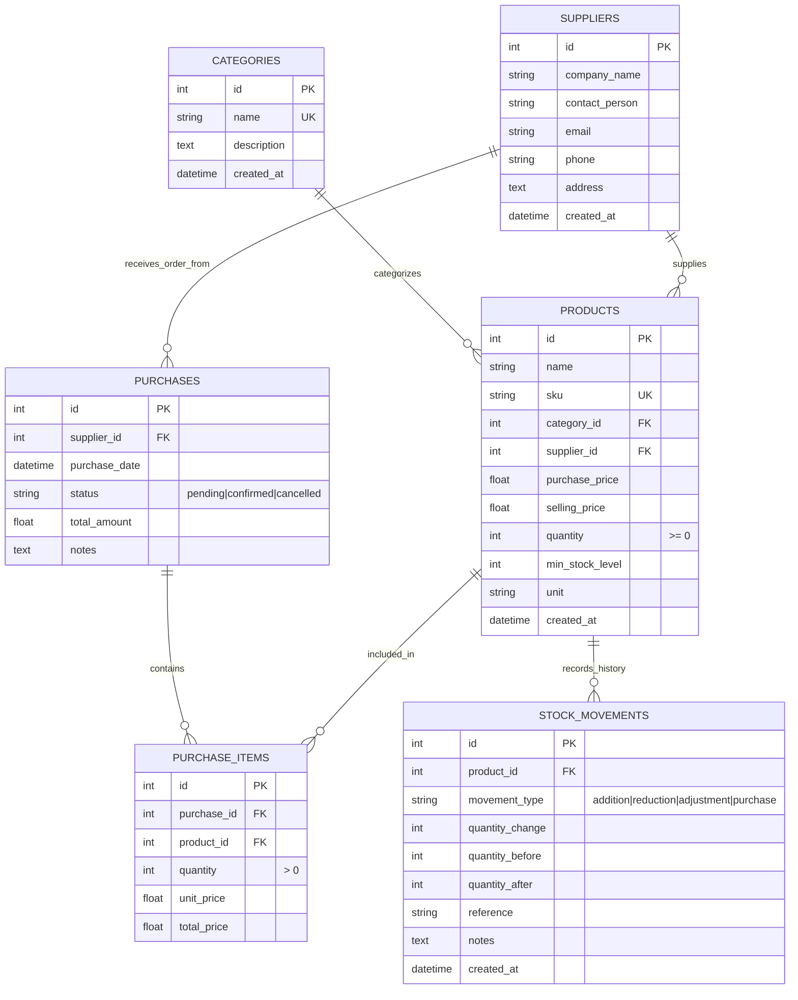

# Inventory Management System (IMS)

> **Auspify Technologies Software Development Internship Project**  
> An enterprise-grade, full-stack Inventory Management System tracking products, stock levels, suppliers, purchase orders, movement audit logs, and financial valuation reports.

---

## 🚀 Technology Stack

- **Backend:** Python 3.10+, FastAPI, SQLite, SQLAlchemy 2.0 ORM, Pydantic v2, Pytest
- **Frontend:** React 18, TypeScript, Tailwind CSS, Recharts, Lucide React, Vite
- **Architecture:** Normalized Relational Database (3NF), RESTful APIs, Single-Page Application (SPA)

---

## 🏗️ System Architecture & Database Design

The system implements fully normalized database tables with primary keys, foreign keys, indexes, and check constraints to guarantee business integrity:



---

## 📋 Features Implemented

### 1. Dashboard
- **Live KPI Metrics:** Total Products, Total Stock Quantity, Total Inventory Value (₹), Low Stock Products, Out-of-Stock Products, and Total Suppliers.
- **Visual Analytics:**
  - Category-wise stock distribution bar chart (Recharts).
  - Monthly purchase procurement spend area chart (Recharts).
- **Recent Stock Activity Feed:** Real-time log of the latest 10 inventory additions, deductions, and purchases.
- **Quick Action Triggers:** Add Product, Stock Adjust, and New Purchase Order.

### 2. Product Management
- **Full CRUD:** Add, update, view, and delete products with modal dialogs and form validation.
- **Search & Filter:** Instant search by name, SKU, or description; filter by category, supplier, or stock status (`In Stock`, `Low Stock`, `Out of Stock`).
- **Sorting:** Multi-column sorting by Name, Price, Quantity, and Creation Date.
- **Data Integrity:** Unique SKU constraint enforcement, non-negative quantity checks, and automatic initial stock movement generation.

### 3. Category Management
- Full category CRUD (Add, Update, Delete).
- Product counter per category.
- **View Products by Category:** Modal displaying all catalog items associated with each category.

### 4. Supplier Management
- Full supplier CRUD with complete contact profile (Company Name, Contact Person, Email, Phone, Address).
- Item counter per supplier.
- **Supplier Catalog View:** Modal displaying all products sourced from a selected supplier.

### 5. Stock Management
- **Stock Addition:** Inward / Restock with reason notes.
- **Stock Reduction:** Outward / Sales issues with negative-stock prevention.
- **Stock Adjustment:** Physical count reconciliation to align system and physical inventory.
- **Live Projection:** Dynamic preview of projected balance before committing transaction.
- **Audit Logging:** Every operation automatically writes an immutable record to `stock_movements`.

### 6. Purchase Management (Procurement Workflow)
- **Create Purchase Order (PO):** Select supplier and add multiple product line items with quantities and unit rates.
- **Real-Time Total Calculation:** Automatic grand total calculation as items and quantities are modified.
- **Order Lifecycle:** `pending` ➔ `confirmed` or `cancelled`.
- **Automated Restocking:** Confirming a purchase order instantly updates product inventory quantities and writes corresponding purchase movement records.

### 7. Low Stock & Out-of-Stock Alerts
- Automatic identification of products where `quantity <= min_stock_level`.
- Notification badge counter on top navigation header with quick preview dropdown.
- Suggested reorder quantity algorithm: `max(min_stock_level * 2 - quantity, 0)`.

### 8. Reports & Analytics with CSV Export
- **Inventory Summary Report:** Complete overview of all items, valuation, and statuses.
- **Stock Valuation Report:** Cost value vs. Retail value with projected profit margin calculations.
- **Low Stock Report:** Filtered list of items requiring procurement reorders.
- **Out-of-Stock Report:** Items with zero quantity.
- **Purchase Report:** Historical procurement expenditures and supplier summaries.
- **Supplier Performance Report:** Total purchased value and product count per supplier.
- **Stock Movement Report:** Full chronological transaction audit history.
- **Live CSV Export:** One-click CSV download for all 7 report types.

### 9. Settings
- Organization profile (Company Name, Warehouse Location).
- Display currency configuration (INR ₹, USD $, EUR €, GBP £).
- Default low stock alert threshold configuration.
- System and architecture diagnostic status overview.

---

## 🛠️ Installation & Setup Guide

### Prerequisites
- Python 3.10 or higher
- Node.js v18+ and npm

### 1. Backend Setup

```bash
cd backend

# (Optional) Create virtual environment
python -m venv venv
venv\Scripts\activate   # On Windows
# source venv/bin/activate # On Linux/macOS

# Install dependencies
pip install -r requirements.txt

# Seed the database with sample inventory data
python seed_data.py

# Start FastAPI server
python -m uvicorn main:app --host 127.0.0.1 --port 8001 --reload
```

FastAPI Swagger API Documentation will be available at:  
👉 **http://127.0.0.1:8001/docs**

### 2. Frontend Setup

```bash
cd frontend

# Install npm dependencies
npm install

# Start Vite dev server
npm run dev
```

The application dashboard will be live at:  
👉 **http://127.0.0.1:5174**

---

## 🧪 Testing

The system includes a test suite covering all CRUD operations, negative stock business constraints, purchase transactions, and report generation:

```bash
cd backend
pytest test_api.py -v
```

### Test Suite Results:
- `test_category_crud` - PASSED
- `test_supplier_crud` - PASSED
- `test_product_crud_and_validation` - PASSED
- `test_stock_operations` - PASSED
- `test_purchase_order_flow` - PASSED
- `test_reports_and_csv_export` - PASSED
- `test_dashboard_stats` - PASSED

---

## 📡 Backend REST API Endpoints

| Method | Endpoint | Description |
|---|---|---|
| `GET` | `/api/dashboard/stats` | Dashboard KPI summary cards |
| `GET` | `/api/dashboard/category-stock` | Stock quantity & valuation by category |
| `GET` | `/api/dashboard/monthly-purchases` | Monthly procurement spend |
| `GET` | `/api/dashboard/recent-movements` | Latest 10 inventory movements |
| `GET` | `/api/products` | List products with search, filter, and sort |
| `POST` | `/api/products` | Create product (unique SKU required) |
| `GET` | `/api/products/{id}` | Get product details |
| `PUT` | `/api/products/{id}` | Update product fields |
| `DELETE` | `/api/products/{id}` | Delete product |
| `GET` | `/api/categories` | List all categories with product counts |
| `POST` | `/api/categories` | Create category |
| `PUT` | `/api/categories/{id}` | Update category |
| `DELETE` | `/api/categories/{id}` | Delete category |
| `GET` | `/api/suppliers` | List all suppliers |
| `POST` | `/api/suppliers` | Register new supplier |
| `PUT` | `/api/suppliers/{id}` | Update supplier details |
| `DELETE` | `/api/suppliers/{id}` | Delete supplier |
| `POST` | `/api/stock/update` | Add, reduce, or adjust stock |
| `GET` | `/api/stock/movements` | Query stock movement audit records |
| `GET` | `/api/purchases` | List purchase orders |
| `POST` | `/api/purchases` | Create purchase order with line items |
| `POST` | `/api/purchases/{id}/confirm` | Confirm PO & credit inventory |
| `POST` | `/api/purchases/{id}/cancel` | Cancel purchase order |
| `GET` | `/api/reports/inventory-summary` | Summary report data (JSON & `/csv`) |
| `GET` | `/api/reports/stock-valuation` | Valuation & margins (JSON & `/csv`) |
| `GET` | `/api/reports/low-stock` | Low stock alerts (JSON & `/csv`) |
| `GET` | `/api/reports/purchases` | Purchase expenditures (JSON & `/csv`) |
| `GET` | `/api/reports/suppliers` | Supplier performance (JSON & `/csv`) |
| `GET` | `/api/reports/stock-movements` | Stock transaction history (JSON & `/csv`) |

---

## 🔒 Business Rules & Integrity Guarantees

1. **Non-Negative Stock Rule:** Stock quantities cannot be decremented below zero. An attempt to issue more stock than available triggers a `400 Bad Request`.
2. **SKU Uniqueness:** Every product SKU must be unique across the catalog. Duplicate SKUs are rejected.
3. **Automated Restocking:** Confirming a Purchase Order automatically increments product stocks and generates `purchase` type movement records.
4. **Audit Immutability:** Every inventory change (creation, manual addition, issue, adjustment, or purchase receipt) is automatically recorded in `stock_movements`.
5. **Dynamic Valuation:** Inventory value is computed accurately as $\sum (\text{quantity} \times \text{purchase\_price})$.

---

## 👥 Internship Information

- **Company:** Auspify Technologies
- **Internship Track:** Software Development Internship
- **Role:** Senior Full-Stack Engineer, Business Analyst & Database Architect
- **Year:** 2026
